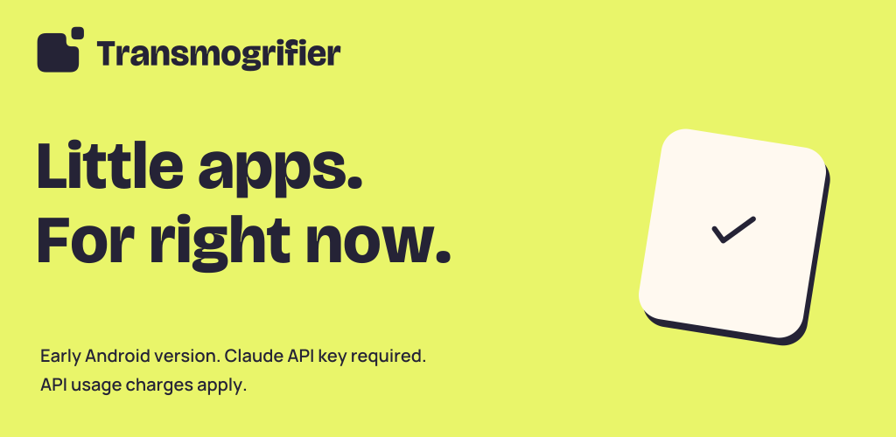

# Transmogrifier

**Little apps. For right now.**

Describe a scorekeeper for tonight, a checklist for the weekend, or another little app you would like to use. Transmogrifier makes it on your Android device. Open it in the built-in browser and ask for changes as you go. Your apps stay until you delete them.

Apps are written by **Claude**, through the Anthropic API. Support for OpenAI is built but disabled until it has been tested.

You use your own API key, and requests are billed to that account. There is no sign-in with a Claude subscription.

## Requirements

- An Android phone or tablet running Android 8.0 or later.
- An API key from the [Claude Console](https://console.anthropic.com/).

## Using the app

### Set up

1. On first launch, the app opens **Settings**. Paste your API key, tap **Save**, then **Check connection**. A passing check shows how many models the key can use.
2. The defaults are ready to use. Open **Advanced settings** to change the **Model for new apps** or adjust:
   - **Thinking effort**: how much the model reasons before answering. More thinking can take longer and cost more.
   - **Steps per request**: how many steps the model may take for one request before it pauses.
   - **Reply limit (tokens)**: the length limit for each model reply. These limits are not spending limits.
   - **Instructions for all apps**: standing instructions the model follows in every app, such as "Use large text". Changes apply from each app's next request.

### Create an app

1. On the projects screen, tap **New app** and give it a name.
2. Describe what you want, for example "a tip calculator with a slider", or tap an example to fill the request box. Tap the send arrow (**Make app**) when ready.
3. The chat shows the model's progress as it writes the files, along with the token usage for each step. The **Files** tab lists the generated files, and tapping one opens a read-only view of its code.
4. Send follow-up prompts, such as "make the button blue", to change the app.

**Stop** interrupts a generation. After a stop, an error, or the step limit, **Continue** picks up where it left off.

### Run an app

Tap **Open app** (the play button) to open the app in the built-in browser. In the toolbar:

- **Reload** loads the app again, including any changes.
- **Error details** shows the app's log. A badge counts the errors.
- **Try to fix it**, in the error panel, returns to the chat and asks the model to fix the errors.

After a run with errors, the chat's **Try to fix it** button also sends them to the model. This sends error details and relevant app context to your AI service; usage charges apply.

### Manage apps

From the menu next to each app on the projects screen, you can rename or delete it. Each app keeps the model it was created with.

## Privacy and safety

- API keys are encrypted with a key held in the Android Keystore and stored only on the device. They are sent only to the provider they belong to.
- Generated apps run in a separate process that never loads the API keys.
- Generated apps can't use the network by default: requests to other sites are blocked. The "Let apps use the network" checkbox in Advanced settings lets them fetch data from, and show images and media from, other https sites. Plain http, remote scripts, styles, and fonts, and form posts stay blocked. Links to other sites open in your regular browser, after you confirm.
- Each generated app has its own storage, so apps can't read each other's saved data.

## Status

Early development. See [docs/plan.md](docs/plan.md) for the development plan and [DEVELOPMENT.md](DEVELOPMENT.md) for building from source.

## License

[MIT](LICENSE)
